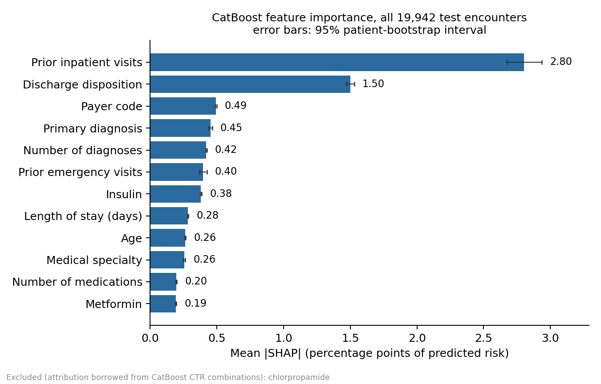
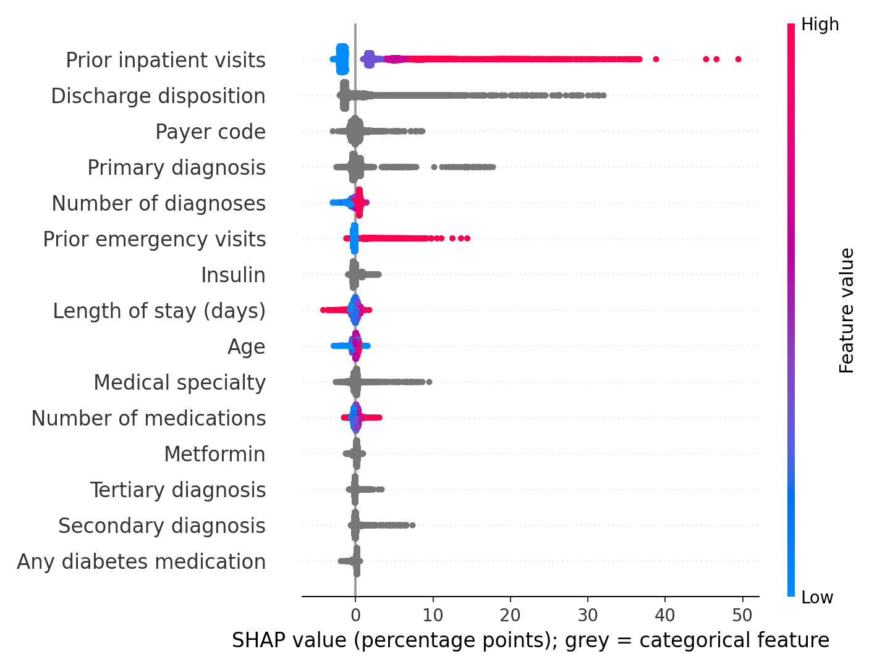
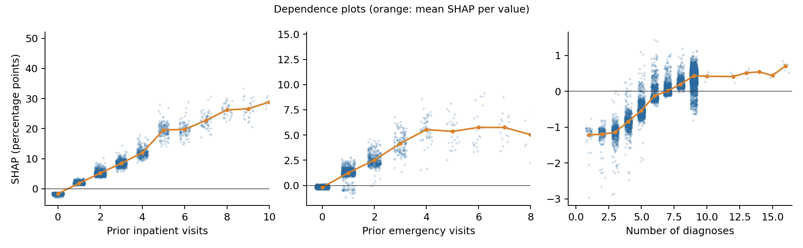
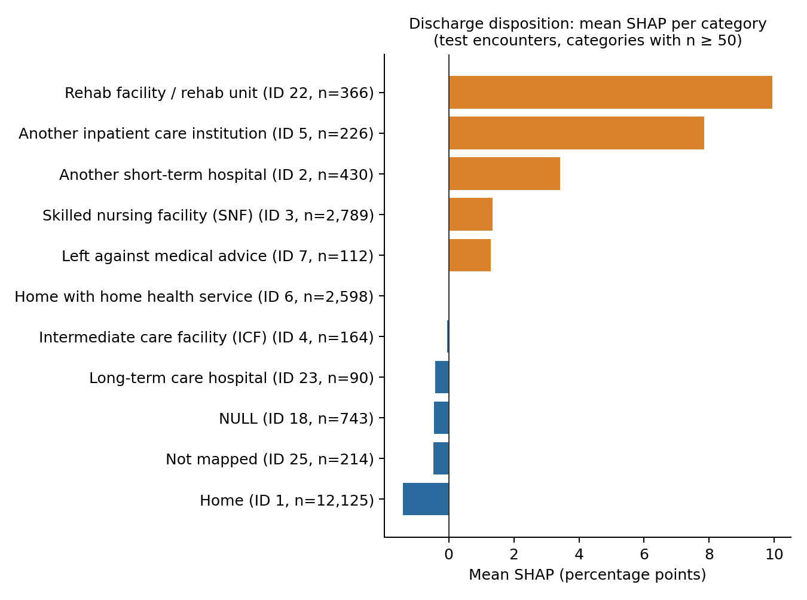
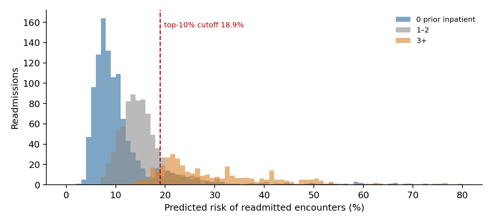
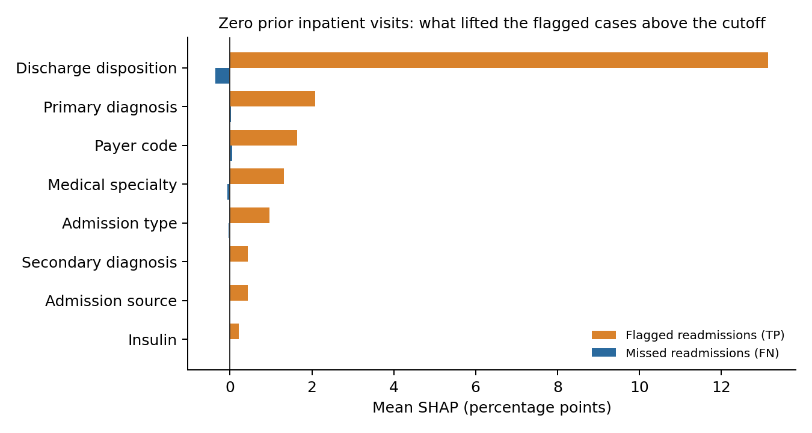
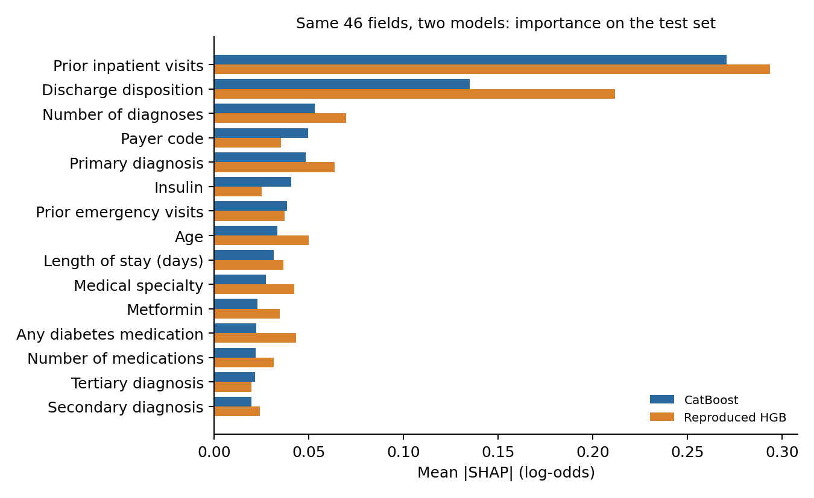

# 指標補齊與 SHAP 延伸分析報告

對應期末簡報 `final_presentation.pdf`（第 27–43 頁）。所有數字都在 Rajpoot 復現的**同一份病人互斥 80/20 切分**上計算：開發集 79,398 筆，測試集 19,942 筆（13,998 位病人，2,297 筆 30 天再入院，盛行率 11.52%）。信賴區間均為**以病人為單位**的 bootstrap（1,000 次，seed 2028，與團隊一致）。

- [一、指標缺口總覽](#一指標缺口總覽)
- [二、逐頁補齊的數字](#二逐頁補齊的數字)
- [三、SHAP 延伸分析](#三shap-延伸分析)
- [四、建議修改的投影片](#四建議修改的投影片)
- [五、注意事項](#五注意事項)

---

## 一、指標缺口總覽

Proposal 承諾的指標是 PR-AUC（AP）、AUROC、Precision／Recall／F1、Brier 與校準曲線。下表列出期末簡報各頁**已報告**與**缺少**的指標。

| 頁 | 內容 | 已報告 | 缺少（本次已補） |
|---|---|---|---|
| 27 | HGB 復現 | AP、AUROC | Brier、校準截距／斜率、AP／AUROC 的 95% CI |
| 30 | Progress 基線（70/15/15） | AP、AUROC、Recall、F1 | **Precision、Brier**（Progress 第 56 頁有，期末版被拿掉） |
| 31 | 類別加權 | AP、top-10% TP | **AUROC、Brier、平均預測風險**、差值 CI、F1 |
| 32 | 複製 vs SMOTE-NC | AP、top-10% TP、兩者差的 CI | **與原始比例的比較**、AUROC、Brier、校準 |
| 34 | CDC | AP、差值 CI | AUROC、Brier |
| 35 | CatBoost vs HGB | 開發／測試 AP、差值 CI | **AUROC 差值 CI**、Brier、AP 絕對值 CI |
| 36 | 相同 recall 下的 precision | 只有折線圖 | 數值表 |
| 37 | 原始 ICD-9 | AP、差值 CI | **AUROC（差異顯著）**、Brier |
| 38–39 | 校準 | Brier、十分位圖 | 校準截距／斜率、ECE、十分位數值 |
| 40 | SHAP | 384 筆抽樣 | 全測試集、CI、方向性、類別層級效果 |
| 41 | 固定 10% 警示量 | TP、FP、Precision、Recall | **F1**、Specificity、NPV |
| 42 | 漏抓案例 | 各層計數 | 漏抓原因（SHAP） |
| 43 | F1／F2 門檻 | CatBoost 的 P／R | **F1、F2 數值**、Specificity、HGB 對照 |
| — | 無 | — | **子群體表現**（性別、年齡、種族、過去住院次數） |
| — | 文獻比較 | 只比 AP／AUROC | 陽性類 F1（Proposal 比較表有此欄） |

---

## 二、逐頁補齊的數字

### 第 27、35 頁：46 欄模型（測試集）

| 方法 | AP [95% CI] | AUROC [95% CI] | Brier | 校準截距／斜率 | ECE |
|---|---|---|---:|---|---:|
| 復現 HGB | 0.2374 [0.2163, 0.2598] | 0.6800 [0.6665, 0.6929] | 0.09650 | 0.148／1.069 | 0.0097 |
| **CatBoost** | **0.2514** [0.2304, 0.2735] | 0.6828 [0.6699, 0.6965] | 0.09582 | 0.217／1.098 | 0.0078 |
| HGB＋CatBoost 50/50 | 0.2494 [0.2276, 0.2712] | 0.6845 [0.6712, 0.6979] | 0.09592 | 0.272／1.130 | 0.0087 |
| CatBoost 原始 ICD-9 | 0.2528 [0.2322, 0.2733] | 0.6874 [0.6746, 0.7007] | 0.09568 | 0.238／1.108 | 0.0074 |

配對差值（病人 bootstrap）：

| 比較 | ΔAP | ΔAUROC | ΔBrier |
|---|---|---|---|
| CatBoost − HGB | +0.0140 [+0.0059, +0.0223] ✔ | +0.0029 [−0.0016, +0.0072] ✘ | −0.00069 [−0.00106, −0.00030] ✔ |
| 50/50 − HGB | +0.0121 [+0.0069, +0.0168] ✔ | +0.0045 [+0.0022, +0.0067] ✔ | −0.00058 [−0.00078, −0.00038] ✔ |
| 原始 ICD-9 − 診斷家族 | +0.0014 [−0.0031, +0.0059] ✘ | **+0.0046 [+0.0008, +0.0082] ✔** | −0.00014 [−0.00037, +0.00009] ✘ |

✔ = 區間不含 0。

**重點**
- CatBoost 的 AP 與 Brier 都顯著優於 HGB，但 **AUROC 的差異不顯著**。這表示 CatBoost 的進步集中在高風險端的排序，跟第 36 頁「recall 20% 時差距最大、之後收斂」一致。
- 原始 ICD-9 的 AUROC 顯著較好，AP 則否。第 37 頁目前只看 AP，結論可以補一句。
- 全部模型的 scaled Brier 只有約 0.05–0.06，也就是說機率預測只比「每個人都猜盛行率」好 6% 左右。這是本資料集的天花板，建議在限制或結論提到。

### 第 36 頁：相同 recall 下的 precision

| Recall | 20% | 40% | 60% | 80% |
|---|---:|---:|---:|---:|
| 復現 HGB | 30.28% | 24.14% | 18.88% | 15.23% |
| CatBoost | 33.09% | 24.46% | 18.78% | 15.08% |

### 第 38–39 頁：校準（CatBoost）

| | 校準截距 | 校準斜率 | ECE（十分位） | Brier | 第 10 十分位 預測／實際 |
|---|---:|---:|---:|---:|---|
| 校準前 | 0.217 | 1.098 | 0.0078 | 0.09582 | 27.33%／29.92% |
| Platt 校準後 | 0.087 | 1.037 | 0.0059 | 0.09576 | 28.64%／29.92% |

斜率 > 1 表示預測值「不夠極端」，高風險端低估，正好對應第 39 頁最高兩個十分位的低估。Brier 的改善 −0.00006 [−0.00013, 0.00000] 很小，但截距、斜率與 ECE 都明顯改善，建議以後兩者為主。十分位完整數值見 `results/tables/calibration_deciles.csv`。

### 第 41、43 頁：操作點

| 模型 | 規則 | 警示比例 | Precision | Recall | **F1** | **F2** | Specificity | NPV |
|---|---|---:|---:|---:|---:|---:|---:|---:|
| HGB | top 10% | 10.00% | 28.34% | 24.60% | 0.263 | 0.253 | 91.90% | 90.35% |
| CatBoost | top 10% | 10.00% | 29.89% | 25.95% | 0.278 | 0.267 | 92.08% | 90.52% |
| CatBoost 原始 ICD-9 | top 10% | 10.00% | 30.29% | 26.30% | 0.282 | 0.270 | 92.12% | 90.57% |
| HGB | 開發集 F1 門檻 0.1361 | 27.16% | 21.03% | 49.59% | 0.295 | 0.390 | 75.76% | 92.03% |
| CatBoost | 開發集 F1 門檻 0.1298 | 26.40% | 21.82% | 50.02% | **0.304** | 0.398 | 76.67% | 92.18% |
| HGB | 開發集 F2 門檻 0.0831 | 60.72% | 15.19% | 80.06% | 0.255 | 0.432 | 41.80% | 94.15% |
| CatBoost | 開發集 F2 門檻 0.0802 | 61.70% | 14.98% | 80.24% | 0.252 | 0.429 | 40.71% | 94.06% |

- 第 43 頁可以加 HGB 對照：在 F2 門檻下，HGB 的 recall 80.1%、specificity 41.8%、警示 60.7%，與 Rajpoot 論文發表的 78.9%／42.2%／60.2% 幾乎一致。
- 原始 ICD-9 版在相同警示量下多抓到 8 筆（604 vs 596）。

### 第 31–32 頁：類別不平衡（重跑版）

團隊產生第 31–34 頁的程式不在三個 repo 中，所以我依照投影片描述，在同一份切分上用復現 HGB 重跑。原始比例與 balanced weights 的 AP **與簡報完全一致**；duplication、SMOTE-NC、CDC 三組因為抽樣實作或 seed 不同，數值略有差異（見最後一欄）。

| 訓練方式 | 開發 AP | 測試 AP | AUROC | **Brier** | **平均預測風險** | ECE | top-10% TP | 簡報 AP |
|---|---:|---:|---:|---:|---:|---:|---:|---:|
| 原始比例 | 0.2209 | 0.2374 | 0.6800 | 0.0965 | 11.4% | 0.010 | 565 | 0.23737 |
| Balanced weights | 0.2130 | 0.2346 | 0.6761 | **0.2146** | **44.8%** | 0.333 | 580 | 0.23458 |
| 複製正例 1:1 | 0.2128 | 0.2287 | 0.6751 | **0.2138** | **44.6%** | 0.331 | 558 | 0.23241 |
| SMOTE-NC 1:1 | 0.1878 | 0.1982 | 0.6520 | 0.1007 | 14.5% | 0.031 | 471 | 0.20900 |

（測試集實際再入院率 11.5%）

與原始比例的配對差值：

| 比較 | ΔAP | ΔAUROC | ΔBrier |
|---|---|---|---|
| Balanced − 原始 | −0.0028 [−0.0085, +0.0027] ✘ | −0.0038 [−0.0072, −0.0004] ✔ | +0.118 ✔ |
| 複製 − 原始 | −0.0087 [−0.0137, −0.0033] ✔ | −0.0048 [−0.0091, −0.0009] ✔ | +0.117 ✔ |
| SMOTE-NC − 原始 | −0.0391 [−0.0498, −0.0293] ✔ | −0.0279 [−0.0368, −0.0198] ✔ | +0.004 ✔ |
| 複製 − SMOTE-NC | +0.0305 [+0.0202, +0.0408] ✔ | +0.0231 [+0.0157, +0.0313] ✔ | — |

**重點**
- Balanced weights 與複製正例會讓**平均預測風險從 11% 變成 45%**，Brier 變成兩倍以上。排序（AP）幾乎不變，但輸出的機率已經不能當成風險。第 31 頁只看 AP 與 TP 數，會漏掉這個代價。
- 用開發集 OOF 做 Platt 再校準可以修回來（Brier 0.0968／0.0971），但仍比不重抽樣差。
- 第 32 頁只比較了「複製 vs SMOTE-NC」。**兩者其實都不如原始比例**：複製 −0.0087，SMOTE-NC −0.039，區間都不含 0。建議在投影片加這一列，以支撐第 44 頁「保留原始權重」的結論。
- SMOTE-NC 的校準斜率 0.77 < 1，表示預測過度極端，與加權的失真方向不同。

### 第 34 頁：CDC（重跑版）

| 特徵 | 測試 AP | AUROC | Brier | 簡報 AP |
|---|---:|---:|---:|---:|
| UCI＋年齡性別群組 | 0.2388 | 0.6776 | 0.09653 | 0.23945 |
| ＋CDC 六項平均＋群組大小 | 0.2403 | 0.6784 | 0.09643 | 0.23927 |
| 差值 | +0.0015 [−0.0024, +0.0056] | +0.0007 [−0.0018, +0.0032] | −0.0001 [−0.0003, +0.0001] | −0.00018 |

重跑結果與簡報結論相同：CDC 在三個指標上都沒有可辨識的增益。第 18 頁的範例（女性 60–69 歲，36,014 人，行走困難 22.23%，BMI 28.54）完全重現。96.5% 的測試病歷能對上 CDC 群組。

### 子群體表現（簡報未呈現）

| 子群體 | 筆數 | 盛行率 | AUROC HGB／CatBoost | AP HGB／CatBoost | O/E（CatBoost） |
|---|---:|---:|---|---|---:|
| 女性 | 10,768 | 11.8% | 0.678／0.680 | 0.240／0.257 | 1.05 |
| 男性 | 9,174 | 11.1% | 0.682／0.686 | 0.235／0.246 | 0.99 |
| < 50 歲 | 3,200 | 11.1% | 0.709／0.719 | 0.298／0.318 | 1.07 |
| 50–69 歲 | 7,897 | 10.9% | 0.698／0.697 | 0.241／0.248 | 1.01 |
| ≥ 70 歲 | 8,845 | 12.3% | 0.646／0.651 | 0.214／0.233 | 1.02 |
| Caucasian | 14,964 | 11.5% | 0.679／0.681 | 0.235／0.252 | 1.01 |
| African American | 3,689 | 12.0% | 0.676／0.681 | 0.255／0.261 | 1.07 |
| 過去住院 0 次 | 13,233 | 8.4% | 0.631／0.631 | 0.158／0.168 | 0.99 |
| 過去住院 1–2 次 | 5,272 | 15.2% | 0.615／0.624 | 0.231／0.252 | 1.08 |
| 過去住院 ≥ 3 次 | 1,437 | 26.9% | 0.613／0.624 | 0.385／0.399 | 1.02 |

- **70 歲以上的鑑別力最差**（AUROC 0.65），也是人數最多的年齡層。
- 性別、主要種族之間差異不大。其他種族組別樣本太小（< 50 個陽性），完整表見 `subgroup_metrics.csv`。
- 在任一過去住院層內，AUROC 只剩 0.61–0.63。模型的整體鑑別力有很大一部分來自「區分不同層」，同層內的排序能力有限。

### 與文獻比較（補陽性 F1）

| 研究 | 驗證方式 | AUROC | AP | 陽性 F1 |
|---|---|---:|---:|---:|
| Liu et al. 2024 | 病人分組 5 折 | 0.640 | — | —（發表的 0.84 非陽性 F1） |
| Emi-Johnson & Nkrumah 2025 | 非病人互斥 80/20 | 0.667 | — | 0.032 |
| Salim & Ibrahim 2026 | 巢狀 CV，非病人互斥 | 0.664 | 0.215 | 0.271 |
| Rajpoot 2026 | 病人互斥 80/20 | 0.677 | 0.237 | — |
| **本組 HGB 復現** | 同上 | 0.680 | 0.237 | 0.295 |
| **本組 CatBoost** | 同上 | 0.683 | 0.251 | **0.304** |

本組的 F1 是用開發集選定的門檻套到測試集，沒有用測試集調門檻。

---

## 三、SHAP 延伸分析

### 方法

- 模型：簡報選定的 46 欄 CatBoost（深度 6、750 棵樹）。用團隊 `selection_lock.json` 重訓，測試 AP 與團隊參考值一致到小數第 10 位。
- 範圍：**全部 19,942 筆測試病歷**（簡報為 384 筆抽樣）。
- 兩種精確的 TreeSHAP：
  - **機率尺度**（percentage points，與第 40 頁單位相同）：interventional TreeSHAP，以 200 筆開發集病歷為參考。
  - **log-odds 尺度**：path-dependent TreeSHAP。
- 兩者都驗證可加性：SHAP 加總 ＋ 基準值 ＝ 模型輸出，誤差 < 1e-8。
- 重要性 CI 與排名 CI 皆為病人 bootstrap（500 次）。

### 1. 全域重要性（第 40 頁更新）

| 排名 | 特徵 | Mean \|SHAP\|（pp）[95% CI] | 排名 95% 範圍 | 第 40 頁（384 筆） |
|---:|---|---|---|---:|
| 1 | 過去住院次數 | 2.80 [2.67, 2.94] | 1–1 | 3.17 |
| 2 | 出院去向 | 1.50 [1.47, 1.53] | 2–2 | 1.81 |
| 3 | 保險別（payer code） | 0.49 [0.48, 0.50] | 3–3 | 0.53 |
| 4 | 主診斷（ICD-9 家族） | 0.45 [0.44, 0.46] | 4–4 | 0.56 |
| 5 | 診斷數 | 0.42 [0.41, 0.43] | 5–6 | — |
| 6 | 過去急診次數 | 0.40 [0.37, 0.42] | 5–7 | 0.65 |
| 7 | Insulin | 0.38 [0.37, 0.39] | 6–7 | — |
| 8 | 住院天數 | 0.28 | 8–8 | — |
| 9 | 年齡 | 0.26 | 9–10 | — |
| 10 | 科別 | 0.26 | 9–10 | — |

- **前兩名非常穩定**：在 1,000 次 384 筆抽樣中，前兩名順序 100% 相同。過去住院次數＋出院去向占全部 |SHAP| 的 45%。
- **第 3–7 名數值接近，384 筆抽樣排不穩**：抽樣後前五名集合相同的比例只有 70%，順序相同只有 46%。
- 第 40 頁的「過去急診次數 0.65」落在 384 筆抽樣的 95% 範圍 [0.33, 0.48] 之外，「出院去向 1.81」也高於 [1.32, 1.71]。差異可能來自參考集不同：換三組參考集時，過去住院次數在 2.49–2.90 之間變動。**建議第 40 頁改用全測試集的數字**，並把「診斷數」「Insulin」補進前 7 名。
- 方向性（beeswarm）：

### 2. 各特徵的效果方向

**過去住院／急診次數**：幾乎線性上升。0 次時 −1.6 pp；1 次 +1.8；2 次 +5.2；3 次 +8.5；5 次以上 +22.7。急診次數在 3 次後趨於平緩。

**出院去向**（括號為測試集實際再入院率）：

- 轉往復健機構（ID 22，30.9%）+9.9 pp
- 轉往其他住院照護機構（ID 5，22.1%）+7.9 pp
- 轉往其他急性醫院（ID 2，15.8%）+3.4 pp
- 轉往 SNF（ID 3，14.4%）+1.3 pp
- 出院回家（ID 1，9.8%）−1.4 pp

SHAP 方向與實際再入院率一致。

**保險別**：**缺值**（39% 的病歷）+0.61 pp；所有有登錄的保險別都是 −0.15 至 −0.75 pp。這個特徵的重要性主要來自「有沒有登錄」，比較可能反映醫院的資料登錄習慣，而不是臨床風險。簡報解讀時建議特別說明。

**主診斷**：補充 V 碼 +1.1 pp（再入院率 15.6%）、精神疾病 +0.7、循環系統 +0.5、內分泌代謝 +0.3。肌肉骨骼 −0.6、症狀未明 −0.4、泌尿生殖 −0.4。

**Insulin**：劑量調降（Down）+0.84 pp、調升（Up）+0.78 pp、未使用 −0.38 pp。住院中調整劑量是風險訊號。

**住院天數**：1–10 天大致隨天數上升（−0.5 → +0.6 pp），但 11 天以上轉為負值（約 −0.8 pp）。11 天以上的實際再入院率並沒有下降（9.7%–17.3%），可能是長住院病人多半出院到機構，風險已經被出院去向吸收。這屬於交互作用，不應解讀為「住久一點比較安全」。

### 3. 漏抓案例分析（第 42 頁「進行中」項目）

固定 top-10% 警示量（1,994 筆，分數門檻 18.92%）：

| 過去住院 | 再入院 | 抓到 | 漏抓 | 該層被警示比例 | 層內 AUROC | 層內 AP（盛行率） |
|---|---:|---:|---:|---:|---:|---|
| 0 | 1,111 | 116 | 995 | 2.6% | 0.631 | 0.168（8.4%） |
| 1–2 | 800 | 138 | 662 | 9.2% | 0.624 | 0.252（15.2%） |
| ≥ 3 | 386 | 342 | 44 | 80.5% | 0.624 | 0.399（26.9%） |

- **警示額度大部分給了過去住院 ≥ 3 次的病人**：1,994 個警示中有 1,157 個（58%）落在這 7% 的病歷上，因為光是過去住院次數就貢獻 +8 到 +17 pp。
- SHAP 基準值（參考集的平均預測）是 10.9%，門檻是 18.9%。過去住院 0 次時，這個特徵固定扣 1.6 pp，所以其他特徵合計要補 +9.6 pp 才能超過門檻。

**0 次層中被抓到的 116 例，靠的幾乎都是出院去向**：

| 特徵（平均 SHAP，pp） | 被抓到（TP） | 漏抓（FN） | 真陰性（TN） |
|---|---:|---:|---:|
| 出院去向 | **+13.1** | −0.4 | −0.7 |
| 主診斷 | +2.1 | +0.0 | −0.0 |
| 保險別 | +1.6 | +0.0 | −0.0 |
| 科別 | +1.3 | −0.1 | −0.1 |
| 平均預測分數 | 30.6% | **8.9%** | **7.9%** |

- 漏抓的 995 例，SHAP 輪廓與真陰性幾乎相同，平均分數只差 1 個百分點。換句話說，**在 46 個出院欄位裡，找不到能區分這群人的訊號**。這是資料的限制，換模型不太可能解決，與第 6 頁「需要理解漏抓案例」的挑戰相呼應。
- 可行方向：外部資料（例如出院後追蹤、社會支持）、或針對 0 次層另設門檻（以召回率換取更多警示）。

### 4. 穩健性檢查

**模型之間一致**（log-odds 尺度的平均 |SHAP|，46 個特徵）：

| 比較 | Spearman | 前 10 名重疊 |
|---|---:|---:|
| CatBoost vs 復現 HGB | 0.93 | 9／10 |
| CatBoost 診斷家族 vs 原始 ICD-9 | 0.93 | 8／10 |

兩個模型的前兩名相同。差異主要是 HGB 較少用到保險別（第 10 名）與 insulin（第 14 名），這兩個都是高基數或類別型特徵，CatBoost 的類別統計（CTR）比 HGB 的序數編碼更能利用。這也是 CatBoost AP 較高的可能原因之一。

**CatBoost 類別組合的歸因偏差（重要）**：
- 原始結果中，**chlorpropamide 排第 11 名**，但測試集 99.9% 的病歷都是「No」。
- 原因：CatBoost 會把多個類別欄位組合成新的 CTR 特徵（本模型 843 個 CTR 中有 746 個是組合），SHAP 會把組合特徵的貢獻**平均分給所有成員欄位**。
- 驗證一：chlorpropamide 的 SHAP 變異只有 0.06% 能由它自己的值解釋（其他前 10 名特徵是 25%–99%）。
- 驗證二：關掉類別組合（`max_ctr_complexity=1`）重訓後，它掉到第 39 名，而前 5 名集合不變，整體排名 Spearman 0.94。
- 因此圖表中已排除 chlorpropamide，表格中以 `flag_borrowed_attribution` 標註。
- 附帶發現：關掉組合後測試 AP 從 0.2514 降到 0.2421。**類別組合是 CatBoost 勝過 HGB 的主要來源之一**，可以放進第 35 頁的解釋。

**參考集敏感度**：在 2,000 筆子集上換三組參考集，前 6 名排序不變。第 7–10 名數值接近（0.22–0.32 pp），順序會互換。數值變動最大的是過去住院次數（2.49–2.90 pp）。

### 5. 與 Salim & Ibrahim 復現的 SHAP 比較

Salim 復現的前 10 名包含 `discharge_group_Expired`（第 3 名）。他們的世代**沒有排除院內死亡**，死亡病人不可能再入院，因此這個特徵是標籤洩漏性質的捷徑。本組依照 Rajpoot 排除死亡與安寧出院，所以出院去向的重要性來自「轉往機構 vs 回家」，不是死亡。兩邊共同的重要特徵是：出院去向、過去住院次數、診斷數、年齡、住院天數。

---

## 四、建議修改的投影片

| 頁 | 建議 |
|---|---|
| 30 | 把 Progress 版本的 Precision（LR 0.1818／RF 0.1783／XGB 0.2068）與 Brier（0.1020／0.1037／0.1014）加回來 |
| 31 | 加 AUROC、Brier 與平均預測風險兩欄；結論補「加權後預測風險變成 45%，必須再校準」 |
| 32 | 加「原始比例」一列作為對照；兩種重抽樣的 AP 都顯著低於原始比例 |
| 35 | 加 AUROC：0.6800 → 0.6828，差值 CI [−0.0016, +0.0072] 不顯著；加 Brier 0.0965 → 0.0958（顯著） |
| 37 | 補「AUROC +0.0046 [+0.0008, +0.0082] 顯著」 |
| 38 | 補校準截距／斜率：0.217／1.098 → 0.087／1.037；ECE 0.0078 → 0.0059 |
| 40 | 改用全測試集數字（2.80／1.50／0.49／0.45／0.42／0.40／0.38），附 CI，並說明 chlorpropamide 被排除的原因 |
| 41 | 加 F1：HGB 0.263、CatBoost 0.278 |
| 42 | 補 SHAP 解讀：0 次層被抓到的靠出院去向（+13 pp），漏抓的與真陰性難以區分 |
| 43 | 補 F1／F2 與 HGB 對照列；HGB 的 F2 操作點與 Rajpoot 論文一致 |
| 44–45 | 結論加「子群體：70 歲以上 AUROC 最低（0.65）」；限制加「scaled Brier 約 0.06」與「保險別的重要性反映缺值」 |
| 8 | 「Interpretation of missed subgroups」可以從 In progress 改成 Completed |

---

## 五、注意事項

- **重跑版與簡報數字的差異**：第 32、34 頁的程式不在共享 repo 中。本報告依投影片描述重建：複製用 `imblearn.RandomOverSampler`、SMOTE-NC 用 `imblearn.SMOTENC`（先插補再序數編碼），seed 皆為 2026。結論方向都與簡報一致，但數值不同。**若要改投影片上的數字，建議請負責的組員把原始程式推上 repo，再用 `scripts/03_metrics.py` 的同一套函式補指標。**
- **CDC 年齡對應**：BRFSS 年齡碼 1–2（18–29 歲）併入 UCI 的 [20-30)，碼 13（80+）對到 [80-90)。UCI 的 [0-10)、[10-20)、[90-100) 無對應群組，依第 18 頁的做法給整體平均、群組大小 0。團隊原始對應方式若不同，CDC 組的數值會略有差異。
- **SHAP 解釋的是模型行為，不是因果**。例如保險別缺值提高預測風險，不代表沒有登錄保險會導致再入院。
- **Platt 校準是單調轉換**，不改變排序與 SHAP 排名。校準後的 log-odds SHAP 等於原值乘以斜率 1.059。
- 所有指標都只在一份測試集上計算。CI 描述的是測試集的抽樣不確定性，不包含訓練的隨機性。
